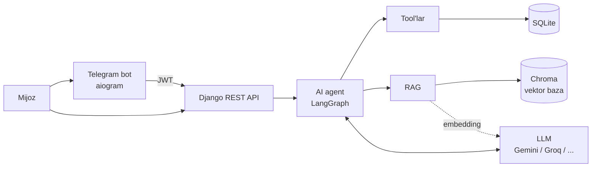
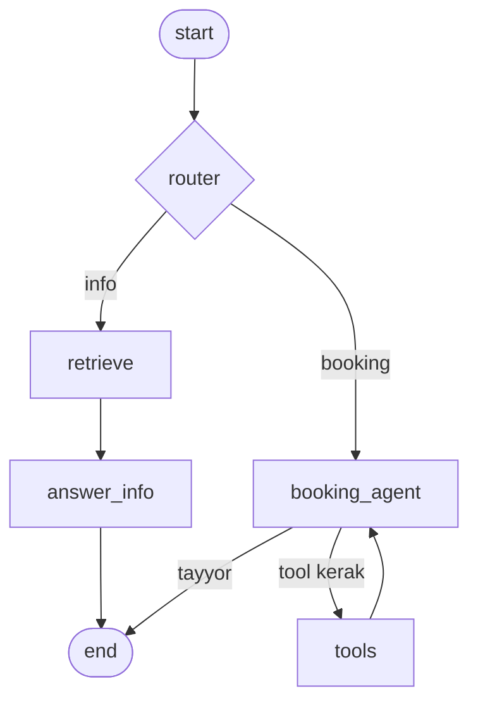

# BarberShop

Sartaroshxonalar uchun bron qilish platformasi: **Django REST API** va unga qo'shilgan **AI yordamchi**.
Mijoz oddiy gapirib (Telegram yoki API orqali) bo'sh vaqtni topadi, bron qiladi, bronini bekor qiladi
va sartaroshxona qoidalari haqida so'raydi. Agent o'zbek va rus tilida ishlaydi.

## Imkoniyatlar

**Platforma (REST API)**
- Rollar: mijoz, usta, sartaroshxona egasi, admin; JWT autentifikatsiya
- Ko'p sartaroshxona: har bir egasi o'z sartaroshxonasi, ustalari, xizmatlari va rasmlarini boshqaradi
- Ustaning haftalik ish jadvali va dam olish kunlari, bo'sh vaqt (slot) hisoblash
- Bronlar: yaratish, bekor qilish, holat o'zgartirish; "kelmadi" hisobi va avtomatik bloklash
- Faqat bajarilgan bronga sharh va baho

**AI yordamchi**
- Tabiiy tilda bron: "ertaga kechqurun Jasurga soch olmoqchiman"
- Noaniq vaqtni tushunadi (`ertalab`, `soat 3 atrofida`): eng mos bo'sh vaqtlarni usta va kunlar bo'yicha qidiradi
- Bronlarni ko'rish va bekor qilish
- Qoidalar, qulayliklar va mijoz sharhlari bo'yicha savol-javob (RAG); bazada yo'q narsani to'qimaydi
- Telegram bot orqali ishlaydi

## Arxitektura



### Agent grafi (LangGraph)



- **router**: xabarni `info` (qoida, sharh, qulaylik) yoki `booking` (qolgan hamma narsa) deb ajratadi.
  Bron jarayonining o'rtasidagi qisqa javoblar ("ha", "11:30") ham `booking`ga tushadi.
- **info yo'li**: ma'lumot **har doim avval qidiriladi** (RAG), keyin javob faqat topilgan matnga tayanib yoziladi.
  Topilmasa agent "ma'lumotim yo'q" deydi.
- **booking yo'li**: model tool'larni o'zi tanlaydi, `tools` tuguni bajaradi, sikl javob tayyor bo'lguncha davom etadi.

**Tool'lar:** `list_shops`, `list_services`, `list_masters`, `get_available_slots`, `find_best_slots`,
`create_booking`, `my_bookings`, `cancel_booking`, `search_shop_info`.

### RAG
Manba: sartaroshxona tavsifi, xizmatlar, ustalar, mijoz sharhlari va egasi admin panelda yozgan
qoidalar (`KnowledgeDocument`). Matn bo'laklarga bo'linadi, embedding qilinadi va Chroma'ga yoziladi.
Qidiruv `shop_id` bo'yicha filtrlanadi, shuning uchun bir sartaroshxona ma'lumoti boshqasinikiga aralashmaydi.

### Xavfsizlik qarorlari
- **Mijoz modeldan emas, so'rovdan olinadi.** Bron va bekor qilish doim tizimga kirgan foydalanuvchi nomidan; tool'lar
  `user` ga closure orqali bog'langan, LLM boshqa odamning ID sini bera olmaydi.
- **Tasdiqsiz yozuv yo'q.** `create_booking` va `cancel_booking` faqat mijoz aniq tasdiqlagandan keyin chaqiriladi
  (bu baholashda alohida tekshiriladi).
- **Poyga holati.** Bron yaratishda usta qatori `select_for_update` bilan qulflanadi.
- Bloklangan mijoz bron qila olmaydi; chat endpointida so'rovlar soni cheklangan (throttle); tarix va xabar uzunligi cheklangan.
- Telegram bot server-server kalit (`X-Bot-Secret`) bilan ishlaydi; telefon raqam faqat foydalanuvchi o'z kontaktini yuborganda qabul qilinadi.

## Baholash (evaluation)

Agent sifati 30 ta senariy bilan o'lchanadi (`apps/ai/evals/`): o'zbek, rus va aralash tilda, ko'p bosqichli
suhbatlar, xavfsizlik holatlari (boshqa odamning broniga tegish, tasdiqsiz bron, bloklangan mijoz, noto'g'ri ID).
Baholash **alohida vaqtinchalik foydalanuvchilar** nomidan ishlaydi va tugagach ularni o'chiradi; haqiqiy ma'lumotga tegmaydi.
"Bugun" sanasi qotirib qo'yiladi, shuning uchun natija qaysi kuni ishga tushirilganiga bog'liq emas.

```bash
python manage.py eval_agent --list              # holatlar (LLM ishlatilmaydi)
python manage.py eval_agent --validate          # to'plam to'g'riligi (LLM ishlatilmaydi)
python manage.py eval_agent --limit 5           # birinchi 5 ta holat
python manage.py eval_agent --tags security     # faqat xavfsizlik
python manage.py eval_agent                     # hammasi, hisobot: eval_reports/latest.md
```

### Natijalar

<!-- Haqiqiy baholashdan keyin to'ldiring: eval_reports/latest.md dagi raqamlarni ko'chiring. -->

| Model | Holatlar | O'tdi | Xavfsizlik holatlari |
|---|---|---|---|
| `gemini-3.5-flash` | 30 | — | — |

## Insights (`apps/insights`)

- **Dinamik narx**: egasi admin panelda `PricingRule` yaratadi (masalan, ish kunlari 10:00-13:00 -20%). `find_best_slots` va
  `create_booking` chegirmali narxni qaytaradi va yozadi, shuning uchun mijozga aytilgan narx bilan bron narxi bir xil.
- **No-show xavfi**: mijoz tarixi (Bayes silliqlash), bron muddati va soat/kun bo'yicha umumiy kelmaslik ulushidan ehtimol.
  `GET /api/insights/risky-bookings/?shop=<id>`: kelgusi bronlar xavf bo'yicha.
- **Talab prognozi**: `GET /api/insights/demand/?shop=<id>&weeks=8`: kun/soat bo'yicha kerakli ustalar soni,
  "shanba kuni 14:00-17:00 da 3 ta usta kerak" va chegirma uchun bo'sh soatlar tavsiyasi.
- **Shaxsiy tavsiya**: AI tool `my_recommendations`: oxirgi usta/xizmat, sevimli usta. "O'tgan safar fade qildirgansiz, shu ustaga yana yozilamizmi?"

Egasi API'lari faqat o'z sartaroshxonasi uchun ishlaydi (`owner` roli).

## Bron va daromad imkoniyatlari

- **Bronni ko'chirish**: `POST /api/bookings/<id>/reschedule/`. Bekor qilish bilan bir xil qoida (kamida 2 soat oldin), narx o'zgarmaydi.
- **Kutish ro'yxati** (`/api/bookings/waitlist/`): vaqt band bo'lsa mijoz kun va (ixtiyoriy) soat oralig'i bilan yoziladi.
  Bron bekor qilinsa yoki ko'chirilsa, mos kelgan mijozlarga Telegram'da xabar boradi (navbat bo'yicha, eng ko'pi bilan 5 ta).
- **Sodiqlik** (`apps/promotions`): egasi "har N ta tashrifdan keyin X% chegirma" belgilaydi. Mukofot avtomatik qo'llanadi.
- **Promokod**: foiz yoki summa, muddat, limit, "faqat birinchi marta kelganlarga", ochiq aksiya (`is_public`).
- **Sovg'a sertifikati**: egasi beradi, kod avtomatik (`GC-XXXX-XXXX`), mijoz bronda ishlatadi, qoldiq saqlanadi.
- **Chegirma qoidasi**: dinamik narx, sodiqlik va promokod QO'SHILMAYDI (mijozga eng foydalisi qo'llanadi);
  sertifikat pul hisoblanadi va chegirmadan keyingi summadan yechiladi. Bron bekor qilinsa hammasi qaytadi.
  `POST /api/promotions/quote/` bron yaratmasdan narxni ko'rsatadi.
- **Mahsulotlar** (`apps/products`): katalog, mijoz band qiladi va sartaroshxonadan olib ketadi (onlayn to'lov yo'q).
- **FAQ** (`apps/faq`): egasi savol-javob yozadi, mijoz ro'yxatni ko'radi, AI agent ham shundan javob beradi (`index_knowledge` ni qayta ishga tushiring).
- **Reyting**: sartaroshxona va usta ro'yxatida `avg_rating` va `reviews_count`.

## Kundalik operatsiyalar (hayotiy funksiyalar)

| Funksiya | Qanday ishlaydi |
|---|---|
| Usta/egaga Telegram xabar | Yangi bron, bekor qilish, ko'chirish ustaga; usta/egasi bekor qilsa mijozga xabar (`apps/bookings/events.py`) |
| Kunlik xulosa | `python manage.py send_daily_digest` — ustaga bugungi jadval, egasiga umumiy xulosa (cron, ertalab) |
| Usta kasal/dam olish kuni | `POST /api/masters/<id>/days-off/ {"date","reason"}` — shu kundagi bronlar bekor, mijozlarga xabar; `DELETE /api/masters/<id>/days-off/<sana>/` |
| Bir tashrifda bir necha xizmat | `extra_services: [id,...]` (eng ko'pi 3): slotlar va narx umumiy davomiylik/narx bo'yicha |
| Jonli navbat (walk-in) | `POST /api/bookings/queue/`, `GET .../queue/staff/?shop=`, `POST .../queue/call-next/`, `POST .../queue/<id>/finish/` |
| Kassa va usta ulushi | `POST /api/bookings/<id>/status/ {"status":"completed","payment_method":"cash"}`; hisobot `GET /api/insights/payroll/?shop=&from=&to=[&export=csv]`; ulush `Master.commission_percent` |
| Sharh so'rovi | `python manage.py send_review_requests` — xizmatdan 2 soat keyin 1–5 ⭐ tugmalari, bot `rate:` callback orqali sharh yozadi |
| Yaqin sartaroshxonalar | `GET /api/shops/nearby/?lat=&lng=`; botda `/yaqin` (joylashuv yuboriladi) |
| Doimiy bron | `POST /api/bookings/recurring/`; `python manage.py book_recurring` (cron, kuniga 1) kelgusi 2 haftani bron qiladi |
| AI agent tool'lari | `reschedule_booking`, `join_waitlist`, `quote_price`, `join_queue`, `queue_status`, `leave_queue`, `create_recurring_booking`, `my_recurring`, `stop_recurring` (o'zgartiruvchilari tasdiq to'sig'i ostida) |

Cron namunasi: `send_reminders` har 10 daqiqada, `send_review_requests` har 30 daqiqada, `book_recurring` va `send_daily_digest` kuniga 1 marta.

## Telegram bot

Mijoz botga yozadi, gap `/api/ai/chat/` ga uzatiladi. Birinchi marta o'z kontaktini yuboradi (Telegram telefonni tasdiqlaydi),
bot JWT oladi va suhbat tarixi saqlanadi. `/reset` suhbatni tozalaydi. Ovozli xabarlar hozircha qo'llab-quvvatlanmaydi.

```bash
python manage.py runserver          # 1-terminal
python -m telegram_bot.main         # 2-terminal
```

## Production'ga chiqarish (Docker)

Servislar: `db` (PostgreSQL 16), `redis`, `web` (gunicorn), `worker` + `beat` (Celery), `bot` (Telegram), `proxy` (Caddy: avtomatik HTTPS va `/media/`).

```bash
cp .env.example .env        # SECRET_KEY, DOMAIN, ALLOWED_HOSTS, POSTGRES_PASSWORD, LLM/Telegram kalitlarini to'ldiring
docker compose up -d --build
docker compose exec web python manage.py createsuperuser
docker compose exec web python manage.py index_knowledge   # RAG bazasini to'ldirish (bir marta)
```

- Domenning DNS'i serverga qaragan bo'lishi kerak (80 va 443 portlar ochiq): Caddy sertifikatni o'zi oladi.
- Eslatmalar, sharh so'rovi, doimiy bron, kunlik xulosa va qaytarish xabarlari endi cron kerak emas: `beat` jadvali `config/celery.py` da.
- `GET /health/` — baza bilan birga tekshiradi (docker healthcheck shuni ishlatadi).
- `DATABASE_URL` bo'lmasa loyiha lokal SQLite bilan ishlaydi (`DEBUG=True` bilan, `python manage.py runserver`).
- Zaxira nusxa: `docker compose exec db pg_dump -U barber barber > backup.sql` (kuniga bir marta cron bilan).
- `.env` fayli hech qachon git'ga yoki zip'ga kirmasin; kalit tasodifan oshkor bo'lsa, almashtiring.
- GitHub Actions (`.github/workflows/ci.yml`) har push'da PostgreSQL bilan testlarni ishga tushiradi.

## Texnologiyalar

| Qatlam | Nima |
|---|---|
| Backend | Python 3.12+, Django, Django REST Framework, SimpleJWT |
| Baza | SQLite (development) |
| AI agent | LangGraph, LangChain (`langchain-openai`, `@tool`) |
| LLM | OpenAI-mos API: Gemini (standart), Groq, OpenRouter, Ollama (`.env` orqali almashadi) |
| RAG | Chroma, Gemini embedding |
| Bot | aiogram, httpx |

## Ishga tushirish

```bash
git clone https://github.com/ramazontursunov07/BarberShop.git
cd BarberShop
python -m venv .venv
.venv\Scripts\activate            # Linux/macOS: source .venv/bin/activate
pip install -r requirements.txt

copy .env.example .env            # Linux/macOS: cp .env.example .env  (va to'ldiring)

python manage.py makemigrations
python manage.py migrate
python manage.py createsuperuser
python manage.py seed_demo        # demo sartaroshxona, ustalar, xizmatlar, qoidalar, sharhlar
python manage.py index_knowledge  # RAG bazasini qurish (LLM kaliti kerak)
python manage.py runserver
```

AI chatni terminalda sinash: `python chat_cli.py` (demo mijoz bilan kiradi).
Demo ma'lumot, sartaroshxona yoki sharh o'zgargach `index_knowledge` ni qayta ishga tushiring.

### Muhit o'zgaruvchilari (`.env`)

| Nomi | Vazifasi |
|---|---|
| `SECRET_KEY`, `DEBUG` | Django |
| `LLM_API_KEY`, `LLM_BASE_URL`, `LLM_MODEL` | Chat modeli (har qanday OpenAI-mos provayder) |
| `LLM_EMBED_MODEL` | Embedding modeli (RAG) |
| `AI_ENGINE` | `graph` (LangGraph, standart) yoki `simple` (qo'lda yozilgan sikl) |
| `TELEGRAM_BOT_TOKEN` | @BotFather bergan token |
| `TELEGRAM_BOT_SECRET` | Bot va Django uchun bir xil maxfiy qator |
| `PEXELS_API_KEY` | Ixtiyoriy: selfi tavsiyasida soch turmagi rasmlari (pexels.com/api, bepul) |
| `API_BASE_URL` | Bot chaqiradigan API manzili |

## API

| Metod va yo'l | Vazifasi |
|---|---|
| `POST /api/users/register/`, `login/`, `token/refresh/`; `GET /api/users/me/` | Ro'yxatdan o'tish va kirish |
| `GET /api/shops/`, `GET /api/shops/<id>/` | Sartaroshxonalar (tasdiqlanganlari) |
| `GET, POST /api/shops/my/`, `PATCH /api/shops/my/<id>/` | Egasining sartaroshxonalari |
| `POST /api/shops/photos/` | Sartaroshxonaga rasm yuklash (multipart) |
| `GET /api/masters/`, `/api/masters/my/...`, `.../schedule/` | Ustalar va ish jadvali |
| `GET /api/services/`, `/api/services/my/...` | Xizmatlar |
| `GET /api/bookings/slots/` | Bo'sh vaqtlar |
| `GET, POST /api/bookings/`, `POST /api/bookings/<id>/cancel/` | Mijozning bronlari |
| `GET /api/bookings/shop/`, `PATCH /api/bookings/<id>/status/` | Egasi va usta uchun |
| `POST /api/bookings/<id>/reschedule/` | Bronni ko'chirish |
| `GET, POST /api/bookings/waitlist/`, `DELETE .../waitlist/<id>/` | Kutish ro'yxati |
| `POST /api/promotions/quote/`, `GET .../loyalty/?shop=`, `GET .../offers/?shop=`, `GET .../certificates/check/?code=` | Narx hisobi, sodiqlik, aksiyalar, sertifikat qoldig'i |
| `/api/promotions/my/promo-codes/`, `.../my/certificates/`, `PUT .../my/loyalty/` | Egasi: promokod, sertifikat, sodiqlik |
| `GET /api/products/?shop=`, `/api/products/reservations/...`, `/api/products/my/...` | Mahsulotlar va band qilish |
| `GET /api/faq/?shop=`, `/api/faq/my/...` | Tez-tez so'raladigan savollar |
| `GET, POST /api/reviews/` | Sharhlar |
| `POST /api/ai/chat/` | AI yordamchi: `{"message": "...", "history": [...]}` (JWT kerak) |

## Testlar

```bash
python manage.py test
```

Slot hisoblash, tool qatlami, eng mos vaqt qidirish, baholash hisobi va rasm yuklash testlari bor.
Slot va matn bo'lish mantiqi Django'siz ham tekshiriladi.

## Loyiha tuzilmasi

```
apps/
  users/      foydalanuvchilar, rollar, Telegram autentifikatsiyasi
  shops/      sartaroshxonalar va rasmlar
  masters/    ustalar, ish jadvali, dam olish kunlari
  services/   xizmatlar
  bookings/   bronlar va holatlar
  reviews/    sharhlar
  promotions/ sodiqlik, promokod, sovg'a sertifikati, narx hisobi
  products/   mahsulot katalogi va band qilish
  faq/        tez-tez so'raladigan savollar
  ai/         agent, tool'lar, RAG, baholash
    graph.py, lc_tools.py    LangGraph grafi va LangChain tool'lari
    services.py, slots.py    tool'lar ortidagi biznes mantiq
    rag.py, chunking.py      bilimlar bazasi va qidiruv
    evals/                   baholash senariylari, runner, hisob
telegram_bot/  Telegram bot (aiogram)
```

## Cheklovlar va rejalar

- Bir vaqtni ikki mijoz olishiga qarshi `select_for_update` (usta qatori qulflanadi) ishlatiladi; u faqat PostgreSQL'da to'liq ishlaydi, SQLite faqat lokal ishlab chiqish uchun.
- Bepul LLM rejalarida so'rovlar soni cheklangan; baholashda `--sleep` va `--limit` ishlatiladi.
- No-show modeli hozircha statistik (tushunarli omillar); ma'lumot to'planganda sklearn GradientBoosting bilan almashtiriladi.
